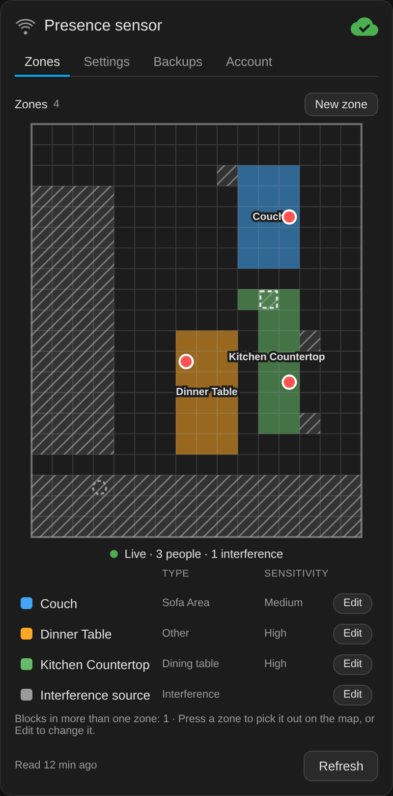
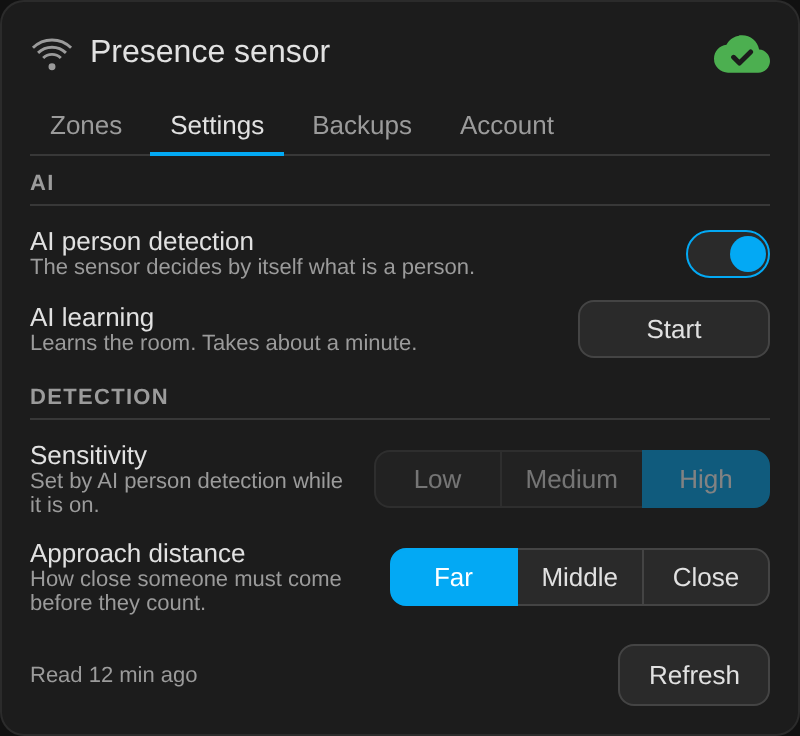

# FP2 Companion Card

[](https://www.home-assistant.io/)
[](https://hacs.xyz/)

A Lovelace card for the Aqara FP2 presence sensor: its settings, a zone
editor with backups, and the live targets on the zone map, the way the Aqara
app shows them.

The card is the front end of the
[Aqara FP2 Companion](https://github.com/sfortis/fp2-companion) integration,
which does the work. The integration talks to the Aqara cloud, creates the
entities and keeps the backups, and the card shows them and sends its
commands to the integration through Home Assistant's websocket.

## Requirements

- The [Aqara FP2 Companion](https://github.com/sfortis/fp2-companion)
  integration, version 2.0.0 or later, installed and signed in to Aqara. The
  card does nothing without it. Its own requirements are listed in
  [its README](https://github.com/sfortis/fp2-companion#requirements). Card
  1.20.x is the last version for the old AppDaemon app.
- HACS, which installs the card and adds its dashboard resource.
- An **admin** Home Assistant user to edit zones, restore backups and see
  the live view. Any user can read the card and change the settings
  that are entities.

<p align="center">
  
  
</p>

> **Unofficial.** This project is not affiliated with Aqara or Lumi.

## Installation

1. Install and set up the [FP2 Companion](https://github.com/sfortis/fp2-companion)
   app.
2. In HACS, search for **FP2 Companion Card** and download it. If the
   search does not find it yet, add
   `https://github.com/sfortis/fp2-companion-card` as a custom repository of
   type **Dashboard** instead. HACS adds the dashboard resource for the card
   and updates it on every release.
3. Add the card to a dashboard:

```yaml
type: custom:fp2-companion-card
```

### Moving From the Card the App Installed

Up to version 1.3.1, the FP2 Companion app copied this card into Home
Assistant's `www/fp2-companion/` folder and added a dashboard resource for
it. Newer versions of the app no longer do that, so the copy stops receiving
updates. After installing the card from HACS:

1. In **Settings > Dashboards**, open **Resources** from the menu at the
   top right, and delete the resource whose URL starts with
   `/local/fp2-companion/`.
2. Delete the folder `www/fp2-companion/` from your Home Assistant
   configuration folder.
3. Reload the browser.

If you had added a resource for the card by hand, for example with
`card_install: false`, delete that one too, so that only the HACS resource
loads the card.

Until the old resource is gone, both copies load and the one that loads
first is used, which may be the old version. The browser console then shows
a warning, or an error from a copy older than 1.19.0, but the card keeps
working.

## Options

| Option | Default | Meaning |
|---|---|---|
| `title` | `Presence sensor` | The card's title |
| `device` | none | Pins the card to one FP2, by its serial, entity prefix, device id or name, and hides the device picker |
| `devices_entity` | `sensor.fp2_companion_devices` | The app's own sensor |
| `entities` | `{}` | Overrides for entity ids renamed in the registry, on a pinned card |
| `language` | the user's | The card's language, like `it`. Empty follows the Home Assistant user's language; English and Italian ship with the card |
| `text` | per language | Any word on the card, over the language's own |

## Using It

The card has four tabs.

- **Zones** shows the map, the live dots and the legend. Press a zone to
  pick it out on the map, or **Edit** to change it. Editing paints blocks by
  tapping or dragging. **Delete** needs a second press. The FP2 looks at
  every block outside the room's edge, so an edge drawn as a frame around
  the room leaves everything beyond the frame in the room. The card says so,
  and **Fill outside** in the edge's editor adds those blocks to the edge.
- **Settings** has AI person detection, sensitivity, approach distance and
  AI learning. While AI person detection is on, the sensor sets its own
  sensitivity and ignores changes to it, so the control is disabled.
- **Backups** lists the zone backups. Choosing one previews it on the map,
  and **Restore** needs a second press.
- **Account** shows the Aqara account, until when the session is valid,
  **Change login** and **Log out**, which needs a second press.

The cloud icon at the top shows the app's status: green with a check when
all is well, amber with an exclamation mark for a warning, and red with a
cross when there is no session. The line under it explains anything that is
not green.

The live view runs only while the card's map is on screen, and stops when
the card is scrolled away or the screen goes off. The zone editor, the
restore of a backup and the live view need an **admin** Home Assistant user,
because the integration accepts those commands from admins only. The
settings that are entities, such as sensitivity, work for any user.

The card does not sign in. The integration asks for the Aqara account when
it is added, and Home Assistant asks again when Aqara ends the session. The
Account tab shows the account and where to change it.

## Translations

The card follows the Home Assistant user's language. A language lives in
`TRANSLATIONS` in `fp2-companion-card.js`, under the first part of its
language code. A word a language does not have shows in English.

## Development

```
NODE_PATH="$(npm root -g)" node tests/fp2-companion-smoke.js
```

The test needs `jsdom` installed globally, and Python's `cryptography` for
its RSA check. `tests/fp2-companion-render.js` renders the card from a live
Home Assistant to an HTML file for a headless browser screenshot.

## License

MIT
